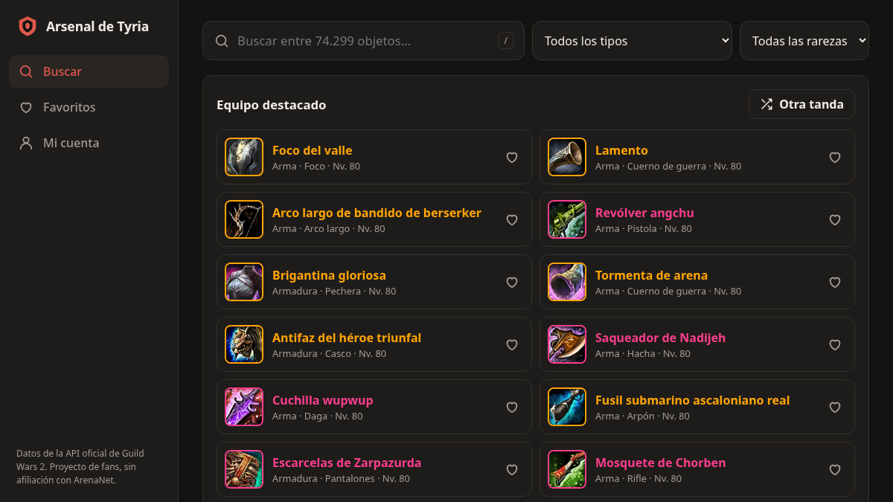
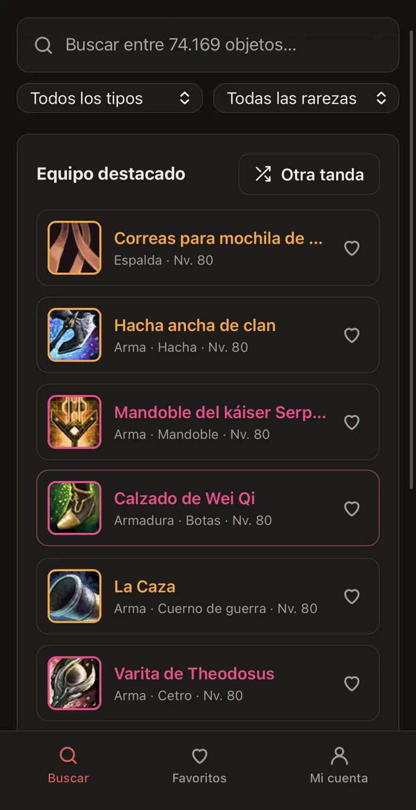
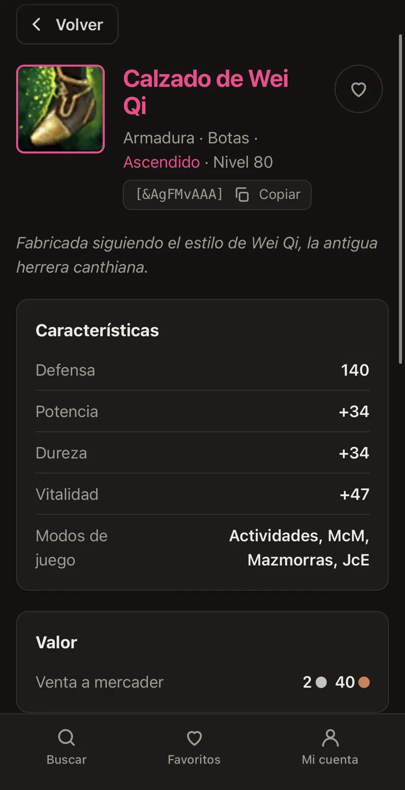
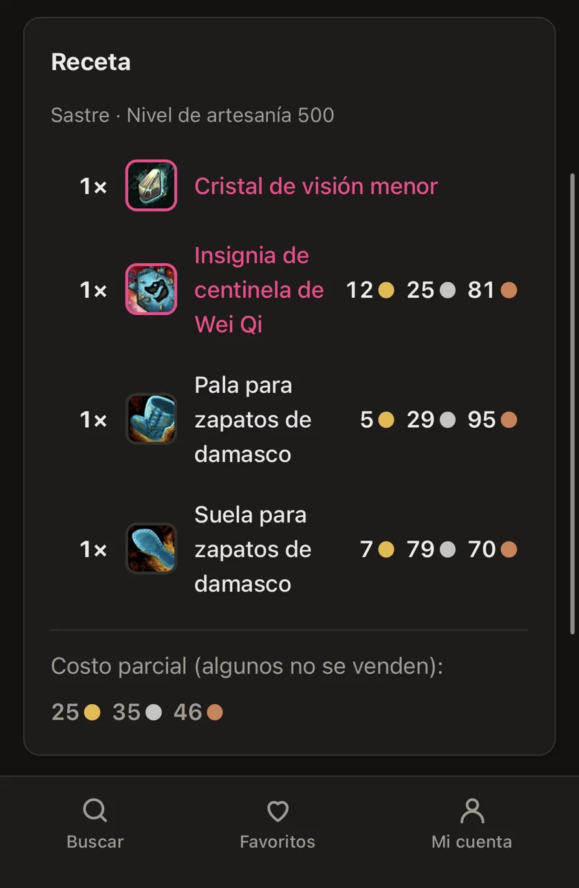
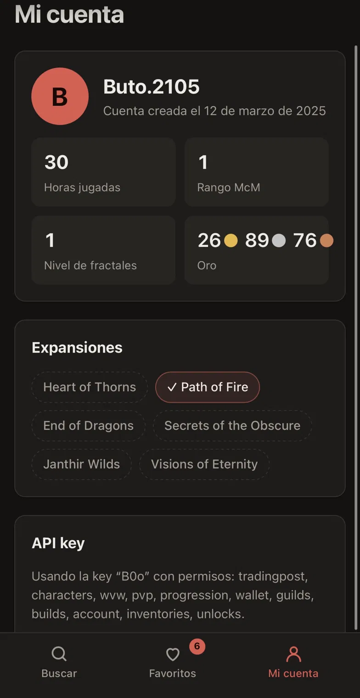

<div align="center">


# Arsenal de Tyria

**Buscador de objetos, recetas y precios del bazar de Guild Wars 2, directo en el navegador.**

[](https://github.com/But0o/Gw2Web/actions/workflows/deploy.yml)


### [🔗 Abrir la app](https://but0o.github.io/Gw2Web/)

</div>

<p align="center">
  
</p>

---

## ¿Qué es?

Arsenal de Tyria te deja buscar cualquiera de los **~74.000 objetos** de Guild Wars 2 al instante, ver
cuánto cuesta fabricarlos según el bazar y consultar los datos de tu cuenta, todo sin instalar nada.

Si querés tenerla a mano, se instala como una app más:

- **PC (Chrome / Edge):** ícono de instalar en la barra de direcciones.
- **iPhone (Safari):** Compartir → *Agregar a pantalla de inicio*.
- **Android (Chrome):** menú ⋮ → *Instalar aplicación*.

<p align="center">
  
  
  
  
</p>

## Funciones

| | |
| --- | --- |
| 🔎 **Búsqueda instantánea** | Entre todos los objetos del juego, sin importar tildes, con filtros por tipo y rareza. |
| 📜 **Detalle completo** | Características, atributos, receta con el costo de cada ingrediente en el bazar y en qué otras recetas se usa. |
| 💬 **Enlace de chat** | Copiá el código del objeto y pegalo directo en el chat del juego. |
| ⭐ **Favoritos** | Guardá los objetos que seguís; quedan en tu navegador. |
| 👤 **Mi cuenta** | Con tu API key de GW2: horas jugadas, expansiones, rango de McM y oro. |
| 📴 **Sin conexión** | Lo que ya consultaste sigue disponible aunque no tengas internet. |

> **Privacidad:** no hay servidor propio ni registro. Tus favoritos y tu API key se guardan solo en
> tu navegador (`localStorage`) y la key se usa únicamente para hablar con la API oficial de ArenaNet.

## De Android a la web

Este proyecto es la evolución de [AppGw2](https://github.com/But0o/AppGw2), una app Android que hice
antes. Esa versión descargaba el catálogo entero en cada celular, con unas **370 llamadas a la API**
cada vez. Para la versión web cambié el enfoque:

```
GitHub Actions (todos los días)
  └─ scripts/build-index.mjs ── descarga los 74k ítems ──► public/data/items.json (~1,4 MB gzip)
                                                              │
Navegador                                                     ▼
  ├─ búsqueda ─────────────── filtra el índice local, sin pedir nada a la red
  └─ detalle / precios / cuenta ── consulta la API de GW2 en vivo
```

El índice se arma **una vez por día en GitHub** y la app lo baja en un único archivo. Resultado: la
búsqueda es instantánea, funciona offline y la app anda en cualquier dispositivo con navegador.

## Tecnologías

- **React 19** + **TypeScript** + **React Router**
- **Vite** para desarrollo y compilación
- **vite-plugin-pwa** (Workbox) para la instalación y el modo sin conexión
- **GitHub Actions** + **GitHub Pages** para generar el índice y publicar
- **oxlint** para revisar el código
- Datos de la [API oficial de Guild Wars 2](https://wiki.guildwars2.com/wiki/API:Main)

## Correrlo en tu PC

Necesitás **Node.js 24** o más nuevo.

```bash
git clone https://github.com/But0o/Gw2Web.git
cd Gw2Web
npm install
npm run index   # descarga el catálogo (tarda ~2 minutos, alcanza con hacerlo una vez)
npm run dev     # abre en http://localhost:5173
```

| Comando             | Qué hace                                                   |
| ------------------- | ---------------------------------------------------------- |
| `npm run dev`       | Servidor de desarrollo con recarga automática              |
| `npm run index`     | Vuelve a descargar el catálogo de ítems                    |
| `npm run build`     | Compila la versión de producción en `dist/`                |
| `npm run preview`   | Sirve `dist/` para probar la versión compilada (y la PWA)  |
| `npm run typecheck` | Revisa los tipos de TypeScript                             |
| `npm run lint`      | Revisa el código con oxlint                                |

## Estructura

```
scripts/
  build-index.mjs     genera el índice de ítems desde la API
src/
  App.tsx             navegación y rutas
  lib/
    catalog.ts        carga y decodifica el índice
    gw2.ts            cliente de la API de GW2
    search.ts         búsqueda y orden por relevancia
    user.ts           favoritos y API key
    storage.ts        acceso a localStorage
    labels.ts         traducciones de los valores de la API
    format.ts         formato de monedas, fechas y números
  pages/              Buscar, Detalle, Favoritos y Mi cuenta
  components/         piezas de interfaz reutilizables e íconos
```

## Publicación

El workflow [`deploy.yml`](.github/workflows/deploy.yml) compila y publica en GitHub Pages en cada
push a `main`, y además corre todos los días para sumar los objetos nuevos que agrega el juego.

Si hacés un fork: **Settings → Pages → Source: GitHub Actions** y listo.

---

<div align="center">
<sub>
Proyecto de fans, sin afiliación con ArenaNet.<br />
Guild Wars 2 y sus recursos son © ArenaNet, LLC.
</sub>
</div>